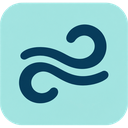
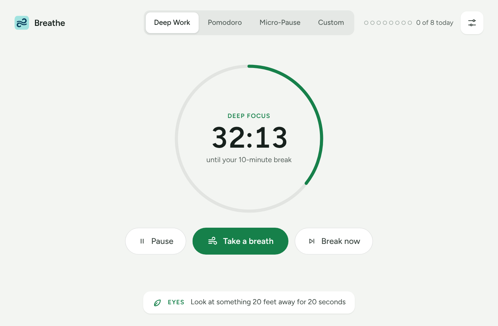
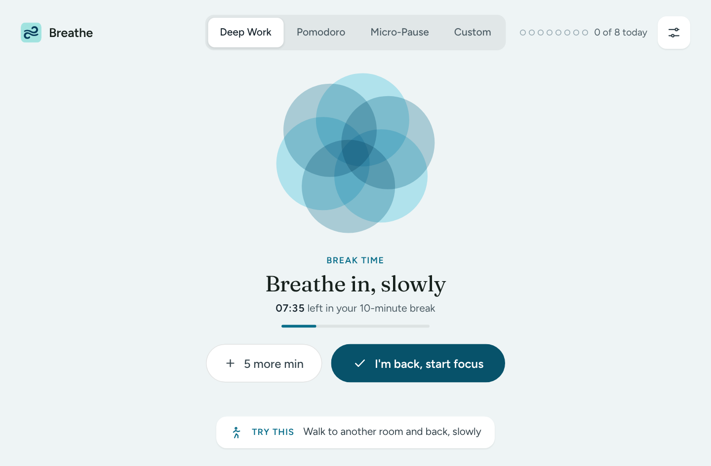
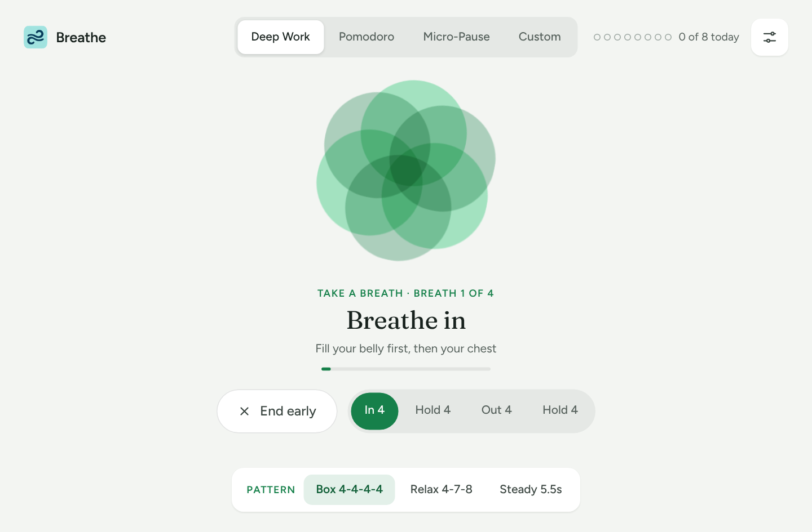
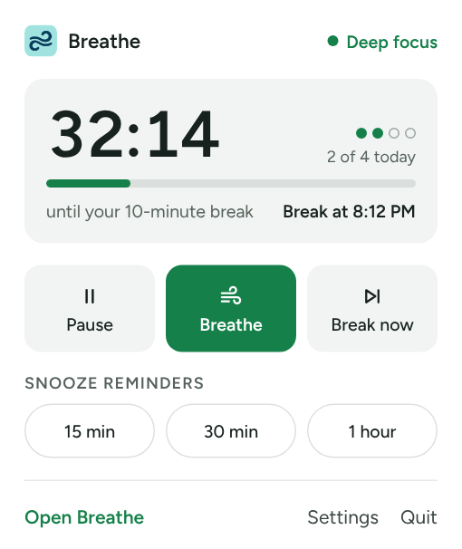
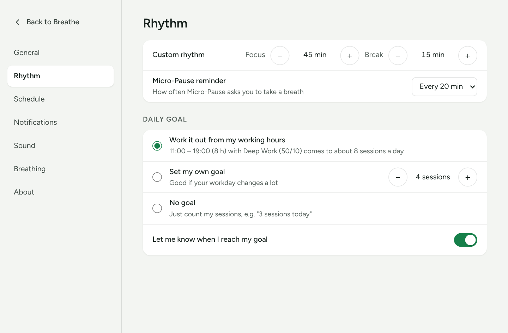
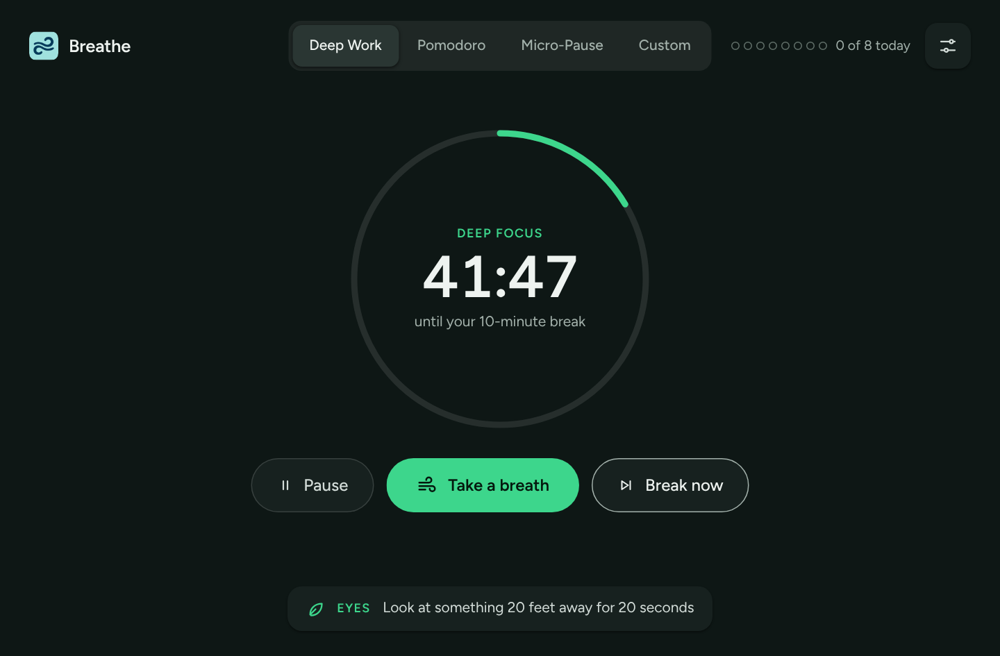

<p align="center">
  
</p>

<h1 align="center">Breathe</h1>

<p align="center">
  A calm work–rest rhythm for people who work from home.<br />
  Focus sessions, real breaks, and a one-minute guided breath whenever you need it.
</p>

<p align="center">
  <a href="https://github.com/mstech66/breathe/releases/latest"><strong>Download for Windows or macOS</strong></a>
</p>

<p align="center">
  
</p>

---

## Why Breathe

Working from home makes it easy to sit for hours without moving, blinking or breathing properly. Pomodoro timers tell you *when* to stop, but not what to do with the break. Meditation apps are great, but they don't live next to your work.

Breathe sits quietly in your tray and does both. It keeps your focus rhythm, tells you when to step away, and turns each break into something that actually helps: a slow breath, a stretch, a look out of the window.

- **Lives in the tray.** Close the window and it keeps running. Click the icon for a quick popover.
- **Breaks that do something.** Each break comes with a breathing guide and a small suggestion to move.
- **One-minute reset.** "Take a breath" gives you a guided breathing session at any moment.
- **Private by design.** No account, no tracking, no network. Everything stays on your computer.

## Features

### Work–rest rhythms

Pick a rhythm from the tabs at the top. Your choice is remembered.

| Rhythm | Focus | Break | Good for |
|---|---|---|---|
| **Deep Work** | 50 min | 10 min | Long stretches of focused work |
| **Pomodoro** | 25 min | 5 min | Short sprints and busy days |
| **Micro-Pause** | Reminder every 15–60 min | A few breaths | Staying aware without a strict schedule |
| **Custom** | 5–180 min | 1–60 min | Your own rhythm (set it in Settings → Rhythm) |

- **Start when you're ready.** Breathe waits at "Ready when you are" until you press **Start focus**, or starts on its own if you turn that on in Settings.
- **Pause, resume, or start your break early** from the main window, the tray popover or the tray menu.
- **Accurate timing.** The timer follows the real clock, so it stays correct even when the window is hidden or your computer is busy.

### Breaks



When a focus session ends, Breathe switches to a calmer teal theme and opens the break screen:

- A **breathing flower** that slowly opens and closes, with "Breathe in / Breathe out" cues
- **Time left** in your break, with a progress bar
- A **"Try this" suggestion** that changes each break: stretch, refill your water, rest your eyes, walk to another room
- **5 more min** if you need a longer break, or **I'm back, start focus** to start again early

If you're away from your desk, the next focus session starts on its own when the break ends.

### Take a breath



A guided breathing session of about one minute, available at any time from the main window, the tray, or the **🌸 Breathe Now** button on a Windows notification. The flower follows your breath, the steps light up as you go, and Breathe returns to your focus timer when you're done. Your timer keeps running in the background.

| Pattern | Steps | Breaths |
|---|---|---|
| **Box** | In 4 · Hold 4 · Out 4 · Hold 4 | 4 |
| **Relax (4-7-8)** | In 4 · Hold 7 · Out 8 | 3 |
| **Steady** | In 5.5 · Out 5.5 | 5 |

### Daily goal

The counter in the top-right corner shows how many focus sessions you've finished today.

- **Dots** for goals of up to 8 sessions, and a **small progress bar** for bigger goals
- **"Goal met"** with a check mark when you reach it. It's a goal, not a limit, so the count keeps going.
- Choose how the goal is set in **Settings → Rhythm**:
  - **Work it out from my working hours** (default). For example, 11:00–19:00 with Deep Work comes to about 8 sessions.
  - **Set my own goal**, from 1 to 24 sessions
  - **No goal**, which shows a plain count such as "3 sessions today"
- An optional notification when you reach your goal
- The count resets every day at midnight.

### Tray icon and popover



Breathe keeps running in the tray when you close its window.

- **Left-click** the icon to open the **popover**: time left, today's sessions, when your next break starts, and quick buttons for Pause, Breathe, Break now and Snooze. It closes when you click anywhere else or press Esc.
- **Right-click** for the menu: Open Breathe, Take a breath, Pause / resume, Start break now, Snooze, Settings and Quit.
- **Double-click** to open the main window.
- **Hover** to see the time left, for example "Breathe · break in 12 min".
- **Closing the window** hides Breathe to the tray and opens the popover, so you can see it's still running. You can change this to quit instead in Settings.

### Snooze

Snooze reminders for 15 minutes, 30 minutes or 1 hour from the tray popover or the tray menu, for example when a break would land in the middle of a meeting. The timer pauses and picks up again on its own, and the main window shows when reminders come back.

### Notifications and sound

- **Native notifications** on Windows and macOS when a break starts, when a break ends, for each Micro-Pause reminder, and when you reach your daily goal
- On Windows, notifications include a **🌸 Breathe Now** button that opens a guided breath
- **Gentle chimes** made in the app (no sound files): a low bowl when a break starts and a bright two-note chime when focus starts
- Volume control and previews in **Settings → Sound**

### Posture and wellbeing tips

The focus screen shows a short tip that changes every 15 seconds, such as "Drop your shoulders away from your ears" or "Look at something 20 feet away for 20 seconds". You can turn tips off in **Settings → Breathing**.

### Settings



Open Settings from the slider icon in the top-right corner or from the tray. Every setting is saved and kept between launches.

| Section | Settings |
|---|---|
| **General** | Launch Breathe at login · Start the timer when Breathe opens · Keep running in the tray or quit when you close the window |
| **Rhythm** | Custom focus and break lengths · Micro-Pause interval · Daily goal (automatic, your own, or none) · Notify me when I reach my goal |
| **Schedule** | Working hours · Only remind me during working hours (the timer pauses on its own outside them) |
| **Notifications** | Show notifications · Send a test notification · Help if notifications don't appear |
| **Sound** | Chimes on or off · Volume · Preview each chime |
| **Breathing** | Default pattern for "Take a breath" · Show posture and wellbeing tips |
| **About** | Version · Source code link · Reset all settings |

### Looks right everywhere

- **Light and dark mode**, following your system setting

  

- **Green for focus, teal for breaks**, so you can tell the phase at a glance
- **Reduced motion** is respected: the flower stays still and the text cues still guide you
- Keyboard friendly, with visible focus outlines. **Esc** closes Settings and the guided breath.
- Fonts are bundled, so it looks the same on Windows and macOS and works fully offline.

## Download and install

Get the latest version from the [Releases page](https://github.com/mstech66/breathe/releases/latest).

| Platform | File |
|---|---|
| **Windows 10 / 11** | `.msi` or `-setup.exe` |
| **macOS** (Apple Silicon and Intel) | `.dmg` |

**First launch notes**

- **Windows:** if SmartScreen shows "Windows protected your PC", choose **More info → Run anyway**. This appears because the app isn't code-signed yet.
- **macOS:** the app isn't notarized yet. Right-click Breathe in Applications, choose **Open**, then confirm. When asked, allow notifications so reminders can appear.

## Getting started

1. Open Breathe and pick a rhythm. **Deep Work** is a good place to start.
2. Press **Start focus**.
3. Close the window when you like. Breathe keeps running in the tray.
4. When your break starts, step away, follow the flower, and try the suggestion.
5. Need a reset mid-session? Press **Take a breath**.

Then open **Settings** to set your working hours, turn on **Launch Breathe at login**, and use **Send a test** to check that reminders reach you.

## Build from source

### Requirements

- [Node.js](https://nodejs.org/) 20 or newer
- [Rust](https://www.rust-lang.org/tools/install) (stable)
- The Tauri prerequisites for your platform: see [Tauri's prerequisites guide](https://tauri.app/start/prerequisites/). On Windows that's the Microsoft C++ Build Tools and WebView2, which is already installed on Windows 11.

### Run it

```bash
git clone https://github.com/mstech66/breathe.git
cd breathe
npm ci
npm run dev      # start the app with live reload of the frontend
```

### Build an installer

```bash
npm run build    # installers are written to src-tauri/target/release/bundle/
```

### Work on the interface in a browser

The frontend is plain HTML, CSS and JavaScript with no build step, so you can open it in any browser while you work on the design:

```bash
npx serve src    # then open the URL it prints; tray.html shows the popover with sample data
```

Desktop-only features (notifications through the OS, the tray, launch at login) are skipped in the browser, and everything else works.

### Releasing

Pushing a tag that starts with `v` (for example `v1.1.0`) runs the [release workflow](.github/workflows/release.yml), which builds Windows and macOS installers and publishes them as a GitHub release. Update `version` in `src-tauri/tauri.conf.json` first so the installers carry the right version.

## How it works

```
breathe/
├── src/                     Frontend (HTML, CSS, JavaScript, no build step)
│   ├── index.html           Main window: focus, break, take a breath, settings
│   ├── main.js              Timer, rhythms, breathing sessions, settings, daily goal
│   ├── styles.css           Design tokens, light/dark and break themes
│   ├── tray.html / tray.js  Tray popover window
│   └── assets/              Logo and bundled fonts
└── src-tauri/               Desktop shell (Rust, Tauri 2)
    ├── src/lib.rs           Tray icon, menu and popover, notifications, close behaviour
    ├── tauri.conf.json      Windows, bundling and app metadata
    └── capabilities/        Permissions the frontend is allowed to use
```

- **One source of truth.** The timer runs in the main window, which stays alive in the background when hidden. The tray popover is a separate window that only displays the timer state the main window broadcasts, and sends its button presses back.
- **Real-clock timing.** Each tick measures the actual time elapsed, so a minimized or throttled window never drifts or misses a break.
- **Local storage only.** Settings and today's session count are saved in the app's local storage. Nothing leaves your computer.
- **Native where it matters.** Windows notifications use WinRT toasts (with the Breathe Now action), macOS uses the UserNotifications framework, and launch at login uses [`tauri-plugin-autostart`](https://v2.tauri.app/plugin/autostart/).

## Roadmap

Ideas being considered for future versions:

- First-run setup that walks through rhythm, working hours, notifications and launch at login
- Pause automatically when you're away from your computer or the screen is locked
- Guided stretch and eye-exercise breaks with simple illustrations
- A weekly summary of focus sessions and breaks taken
- An end-of-day "wind down" reminder
- Global keyboard shortcuts

Suggestions are welcome. Open an [issue](https://github.com/mstech66/breathe/issues) to share one.

## Contributing

Bug reports and pull requests are welcome.

1. Fork the repository and create a branch for your change.
2. Run `npm run dev` and try your change on the platform you're working on.
3. Open a pull request describing what changed and how you tested it. Screenshots help for anything visual.

## Credits

- Built with [Tauri 2](https://tauri.app/)
- Fonts: [Figtree](https://github.com/erikdkennedy/figtree) and [Fraunces](https://github.com/undercasetype/Fraunces), both under the SIL Open Font License (see `src/assets/fonts/`)
